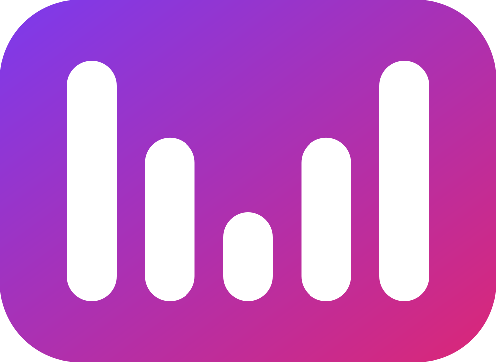

 

# MusicBeat

### Aesthetic YouTube Music Client

 

 

[**Download**](#download) · [**Features**](#features) · [**Contributing**](#contributing) · [**Credits**](#credits) · [**Disclaimer**](#disclaimer)

> [!NOTE]
> MusicBeat is a fork of [BitChord](https://github.com/kushagrasinghx/BitChord) by Kushagra Singh, released under the same [GPL-3.0](LICENSE) licence. It installs as its own app (`com.musicbeat.app`) next to BitChord.

> [!IMPORTANT]
> MusicBeat is not affiliated with, endorsed by, or connected to YouTube or Google in any way. Use it at your own discretion.

---

<h1>Features</h1>

<table>
  <tr>
    <td width="50%" valign="top">

#### Playback
- **Search, browse and play** anything available on YouTube Music.
- **Hi-Res lossless audio** — FLAC/ALAC from a configured module source, with YouTube Music as fallback.
- **Gapless playback with true crossfade**, adjustable 0–12s.
- **Automix [Beta]** — DJ-style transitions with beat-matching and tempo-stretching.
- **Offline downloads** — save tracks with embedded metadata.
- **Local music library** integration.
- **Background playback** via a proper foreground media session.
- **Apple-like lyrics animation** — credit to [binimum](https://github.com/binimum/am-lyrics).

#### Connectivity & Accounts
- **Sign in with your Google account** for personalized content.
- **Spotify integration** — connect your account to play your playlists and Liked Songs.
- **Scrobbling** to Last.fm and ListenBrainz.
- **Listen Together** — on a party server you run yourself.
- **Pluggable sources** — add, edit, test and health-check module sources.

    </td>
    <td width="50%" valign="top">

#### Experience
- **Animated album canvas** — motion artwork on the now-playing screen.
- **Word-synced lyrics** — word/syllable-level highlighting from multiple sources, matched to the exact recording.
- **Lyrics providers** — credit to [lrc.red](https://lrc.red), [BiniLyrics](https://github.com/binimum), [BetterLyrics](https://github.com/better-lyrics/better-lyrics), [PaxSenix](https://lyrics.paxsenix.org), [LyricsPlus](https://github.com/ibratabian17/YouLyPlus), [SimpMusic](https://github.com/maxrave-dev/SimpMusic), [Unison](https://unison.boidu.dev), [Megalobiz](https://www.megalobiz.com), [KuGou](https://www.kugou.com), [LRCLIB](https://lrclib.net), [Musixmatch](https://www.musixmatch.com) and [Genius](https://genius.com).
- **Dynamic, artwork-driven theming** — Material palette extracted from album art.
- **Frosted-glass UI** — Telegram-style translucent bars via Haze, Material 3 theming.

#### Controls & Tweaks
- **Equalizer** — tone pad or seven bands, your own saved presets, and a profile per output (phone speaker, wired, each Bluetooth device). Also in the player menu.
- **Per-network audio quality** — separate quality ceilings for Wi-Fi and mobile data.
- **Playback speed control** (0.5×–2.0×) and **skip silence**.
- **Sleep timer** — fixed presets or "stop after this track".
- **Bit-perfect USB exclusive output** — sends lossless tracks to a USB DAC unchanged, at each track's own rate and bit depth. Thanks to [Mornye](https://github.com/mornyeapp/Mornye) for the reference.
- **Stats for nerds** — codec, bit depth, sample rate, and more on the now-playing screen.

    </td>
  </tr>
</table>

---

<h1>Download</h1>

Grab the latest signed APK from the [Releases](https://github.com/Saypul/MusicBeat/releases) page. Most phones want the `arm64-v8a` build. Sideloading requires enabling "Install unknown apps" for whichever app you download it with.

On Windows, take `MusicBeat-<version>-windows-x64-setup.exe` from the newest `windows-v` release on the same page (beta); after that, updates arrive in the app. See the [code signing policy](docs/CODE_SIGNING.md).

---

<h1>Contributing</h1>

Contributions are welcome. Please review the [Contributing Guide](CONTRIBUTING.md) and [Code of Conduct](CODE_OF_CONDUCT.md) before submitting a Pull Request.

[**Contributing Guide**](CONTRIBUTING.md) · [**Code of Conduct**](CODE_OF_CONDUCT.md) · [**Maintainers**](MAINTAINERS.md) · [**Additional Docs**](ADDITIONAL.md)

---

<h1>Credits</h1>

MusicBeat is built on [BitChord](https://github.com/kushagrasinghx/BitChord) by [Kushagra Singh](https://github.com/kushagrasinghx) and [its contributors](https://github.com/kushagrasinghx/BitChord/graphs/contributors). If MusicBeat is useful to you, consider supporting the original project there.

---

<h1>Disclaimer & Legal Notice</h1>

MusicBeat is an independent, community-driven third-party audio player and client. It is **not** associated with Google LLC, YouTube Music, Deezer, Telegram, or any of their parent companies.

* **No Media Hosting:** MusicBeat does not host, upload, or store copyrighted music files. It operates strictly as an interface to scan local device storage or stream media directly from public, public-facing, or user-authenticated APIs.
* **Fair Use & API Usage:** This software is created solely for personal research, educational, and fair-use purposes. The user is entirely responsible for ensuring their usage aligns with their local copyright laws and YouTube Terms of Service.
* **No Ad-Blocking Guarantee:** While MusicBeat focuses on providing a clean listening environment, it does not guarantee permanent bypasses or modifications to commercial third-party platform conditions.
* **Copyleft:** MusicBeat is free software under the GPLv3. The license does not let anyone forbid others from selling or redistributing copies, but any distribution must come with the Corresponding Source under the same license.

---

<h1>License</h1>

This project is licensed under the **GNU General Public License v3.0 (GPLv3)**. See the [LICENSE](LICENSE) file for details.

